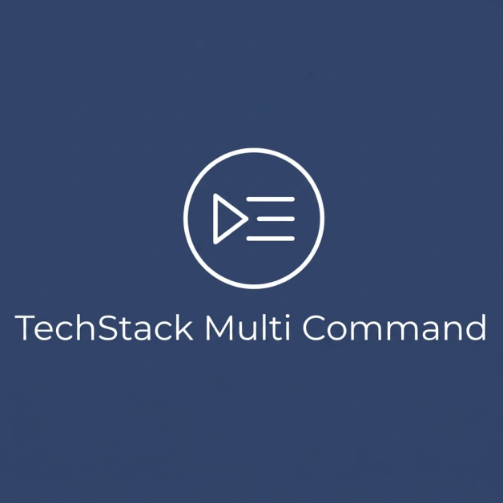

<h1 align="center">
  <a href="https://github.com/ptanmay143/techstack-multi-command">
    
  </a>
</h1>

<div align="center">
  TechStack Multi Command Executor
  <br />
  <a href="#about"><strong>Explore the features »</strong></a>
  <br />
  <br />
  <a href="https://github.com/ptanmay143/techstack-multi-command/issues/new?assignees=&labels=bug&title=bug%3A+">Report a Bug</a>
  ·
  <a href="https://github.com/ptanmay143/techstack-multi-command/issues/new?assignees=&labels=enhancement&title=feat%3A+">Request a Feature</a>
  .
  <a href="https://github.com/ptanmay143/techstack-multi-command/issues/new?assignees=&labels=question&title=support%3A+">Ask a Question</a>
</div>

<div align="center">
<br />

[](LICENSE)
[](https://github.com/ptanmay143/techstack-multi-command/issues?q=is%3Aissue+is%3Aopen+label%3A%22help+wanted%22)
[](https://github.com/ptanmay143)

</div>

<details open="open">
<summary>Table of Contents</summary>

- [About](#about)
  - [Built With](#built-with)
- [Getting Started](#getting-started)
  - [Prerequisites](#prerequisites)
  - [Installation](#installation)
- [Usage](#usage)
- [Roadmap](#roadmap)
- [Support](#support)
- [Project Assistance](#project-assistance)
- [Contributing](#contributing)
- [Authors & Contributors](#authors--contributors)
- [Security](#security)
- [License](#license)
- [Acknowledgements](#acknowledgements)

</details>

---

## About

TechStack Multi Command Executor is a VS Code extension for running a configured command, or a sequence of commands, against one or many files without manually chaining the same actions by hand. It targets the same workflow pattern developers reach for repeatedly when they want to format, organize imports, refactor, or otherwise update a batch of files in a consistent order. The extension is purpose-built for file-centric tasks in an editor and is intentionally narrow: it invokes VS Code commands and extension-provided actions rather than shell scripts or arbitrary system processes.

It is designed for developers working in large repositories, teams maintaining consistent code quality standards, or anyone who wants to apply a repeatable command sequence to selected files, folders, all files in a workspace, or files matching a glob. A common real-world use is running formatters and import cleanup across a TypeScript or JavaScript codebase, but the extension can be used wherever a VS Code command can act on the current document. The workflow model is static, reusable, and stored in VS Code settings rather than hard-coded into the extension.

This project exists to solve a simple but recurring pain point: the VS Code command palette and Explorer context menu are powerful, but they are not well-suited to repeating the same multi-step sequence across many files. The extension captures that workflow as a named, configurable recipe and executes it safely with target filtering, preview, progress reporting, and cancellation behavior that make bulk edits more observable. It is built around the idea that a user should be able to review the exact file set before changes happen and then rely on the output panel for the final results.

At a high level, the extension reads configured workflow definitions from user or workspace settings, resolves the target file set based on the chosen scope and include/exclude rules, previews the matching files, and then runs each workflow step in order for each file. It waits for each command to finish before moving to the next step, saves according to the configured policy, and records success or failure details for the current file. Important constraints come from VS Code itself: the extension cannot guarantee that every arbitrary command will behave consistently in an unattended batch run, and some commands require an active editor, a selection, or user interaction.

<details>
<summary>Screenshots</summary>
<br>

This project has no graphical interface. See [Usage](#usage) for the command-palette and Explorer workflow flows, confirmation steps, and example configuration.

</details>

### Built With

- **VS Code Extension API** — registers commands, menus, settings, and editor/document interactions.
- **TypeScript 5.4.5** — implementation language for the extension and test suite.
- **Node.js / npm** — build, test, packaging, and dependency management via the extension toolchain.
- **minimatch** — glob filtering for workflow include and exclude patterns.
- **Mocha + Node test runner** — automated validation for workflow parsing and extension behavior.

---

## Getting Started

This project is a local VS Code extension that you can clone, build, and run in the Extension Development Host. The setup is lightweight: install dependencies, open the repository in VS Code, and launch the extension with F5 or run the package scripts for compile/test validation.

The implementation is intentionally narrow and dependency-light, and it does not require a service or database to run locally.

### Prerequisites

- **VS Code 1.85.0 or newer** — the extension declares `^1.85.0` in `package.json` and uses the VS Code API surface for commands, document access, and UI dialogs.
- **Node.js and npm** — needed to install dependencies, compile the TypeScript source, and run the automated tests.
- **Git** — required to clone the repository and keep your fork/branch workflow in sync with the GitHub remote.

### Installation

1. Clone the repository:

```bash
git clone https://github.com/ptanmay143/techstack-multi-command.git
cd techstack-multi-command
```

2. Install dependencies:

```bash
npm install
```

3. Build the extension locally:

```bash
npm run compile
```

4. Start the extension in development mode:

Open the folder in VS Code and press `F5` to launch the Extension Development Host. You can also run the extension-host test suite directly with:

```bash
npm run test:extension
```

5. Package a VSIX for local installation if needed:

```bash
vsce package
```

---

## Usage

The extension exposes four primary entry points in the VS Code UI:

- **Run Workflow...** — available in the Explorer context menu under **Run File Workflow** for selected files or folders.
- **TechStack Multi Command Executor: Run Workflow on Workspace...** — processes the files in every workspace folder.
- **TechStack Multi Command Executor: Run Workflow on Glob...** — prompts for a workspace-relative glob and then runs the selected workflow against matching files.
- **TechStack Multi Command Executor: Run Workflow on Folder...** — prompts for a folder and then processes the files it contains.

Before execution, the extension resolves the files that match the target scope, applies workflow include/exclude patterns, de-dups the list, filters out protected directories like `.git`, honors VS Code's configured `files.exclude` values, and previews the resulting target set. The user must confirm the preview before the actual command sequence begins. This safety check is important because VS Code commands can mutate files and the extension cannot automatically roll back those changes.

To configure a workflow, add a named object under `multiCommandRunner.workflows` in your user or workspace settings. The workflow definition includes a required `steps` array of `{ command, args? }` entries as well as optional `label`, `description`, `include`, `exclude`, and `save` settings.

```json
{
  "multiCommandRunner.workflows": {
    "formatAndOrganize": {
      "label": "Format and organize imports",
      "description": "Format supported source files, then organize imports",
      "steps": [
        { "command": "editor.action.formatDocument" },
        { "command": "editor.action.organizeImports" }
      ],
      "include": ["**/*.{ts,tsx,js,jsx}"],
      "exclude": ["**/generated/**"],
      "save": "afterWorkflow"
    }
  }
}
```

`save` is one of `afterWorkflow` (default), `afterEachStep`, or `never`. In `afterWorkflow`, the file is saved only once after all steps succeed. In `afterEachStep`, each successful command saves the document immediately. In `never`, no automatic save occurs, leaving the user to decide whether to preserve results.

The project also exposes a few direct npm scripts that matter to a developer working on the extension itself:

```bash
npm run compile
npm test
npm run test:extension
vsce package
```

- `npm run compile` runs the TypeScript compiler for the extension.
- `npm test` compiles the project and executes the Node-based tests in `test/`.
- `npm run test:extension` runs the VS Code Extension Development Host tests.
- `vsce package` creates the `.vsix` bundle for installation.

Example workflow execution flow:

```text
1. Open a workspace.
2. Run "TechStack Multi Command Executor: Run Workflow on Workspace...".
3. Pick a configured workflow from the Quick Pick.
4. Review the resolved target list.
5. Click "Run Workflow" in the confirmation dialog.
6. Watch progress and output for each file.
7. Review any failures or warnings in the Output panel.
```

The output panel records target paths, command failures, cancellation results, editor-restoration warnings, and summary counts for each run. It does not log file contents or command argument values.

This project has no graphical interface. See the command-palette and Explorer flows above for the supported runtime experience.

---

## Roadmap

See the [open issues](https://github.com/ptanmay143/techstack-multi-command/issues) for the current backlog and bug reports.

- [Top Feature Requests](https://github.com/ptanmay143/techstack-multi-command/issues?q=label%3Aenhancement+is%3Aopen+sort%3Areactions-%2B1-desc)
- [Top Bugs](https://github.com/ptanmay143/techstack-multi-command/issues?q=is%3Aissue+is%3Aopen+label%3Abug+sort%3Areactions-%2B1-desc)

No formal roadmap has been documented yet. See the issue tracker for outstanding work.

---

## Support

Reach out to the maintainer at one of the following places:

- [GitHub Issues](https://github.com/ptanmay143/techstack-multi-command/issues)
- Email: ptanmay143@outlook.com

---

## Project Assistance

If you want to say **thank you** or support active development of techstack-multi-command:

- Add a [GitHub Star](https://github.com/ptanmay143/techstack-multi-command) to the project.
- Write about the project on your blog.

---

## Contributing

First off, thanks for taking the time to contribute! Contributions are what make the open-source community such an amazing place to learn, inspire, and create.

### Development Workflow

1. Fork the Project.
2. Create your Feature Branch (`git checkout -b feature/AmazingFeature`).
3. Commit your Changes using Conventional Commits (`git commit -m 'feat: add some AmazingFeature'`).
4. Push to the Branch (`git push origin feature/AmazingFeature`).
5. Open a Pull Request.

### Code Style & Linting
Ensure all code compiles and passes checks before submitting:
```bash
npm run compile
npm test
```

---

## Authors & Contributors

The original setup of this repository is by [Tanmay Pachpande](https://github.com/ptanmay143).

For a full list of all authors and contributors, see [the contributors page](https://github.com/ptanmay143/techstack-multi-command/contributors).

---

## Security

techstack-multi-command follows good practices of security, but 100% security cannot be assured. techstack-multi-command is provided **"as is"** without any **warranty**. Use at your own risk.

---

## License

This project is licensed under the **MIT License**.

See [LICENSE](LICENSE) for more information.

---

## Acknowledgements

No specific acknowledgements at this time.

<!-- Generated by README_GENERATOR_PROMPT v0.1 -->
